# ggSCvis — User Guide

`ggSCvis` extracts data from a **Seurat** object once and then lets you build
single-cell figures with the ordinary grammar of **ggplot2**. Instead of
learning a new plotting API, you keep using `+`, `aes()`, `scale_*()`,
`theme()` and `facet_*()` — ggSCvis only adds the geoms, facets and theme
pieces that single-cell figures need.

> **Every figure in this guide was generated from the `pbmc3k` dataset using
> exactly the code shown next to it.** The examples mirror the published
> walk-throughs listed under [Related blogs](#related-blogs), so you can
> reproduce each panel line by line.

- [1. Installation](#1-installation)
- [2. Quick start](#2-quick-start)
- [3. Preparing the data](#3-preparing-the-data)
- [4. Plot types](#4-plot-types)
- [5. Adding dendrograms](#5-adding-dendrograms)
- [6. Faceting](#6-faceting)
- [7. Annotation](#7-annotation)
- [8. Theme, scales and coordinates](#8-theme-scales-and-coordinates)
- [9. Compatibility](#9-compatibility)
- [10. Troubleshooting](#10-troubleshooting)
- [Related blogs](#related-blogs)

---

## 1. Installation

```r
# install.packages("devtools")
devtools::install_github("junjunlab/ggSCvis")

# or
remotes::install_github("junjunlab/ggSCvis")
```

Dependencies that are not on CRAN are listed in the `Remotes:` field of
`DESCRIPTION` (`junjunlab/ggcirclize`, `teunbrand/ggh4x`,
`jokergoo/circlize`) and are installed automatically by `install_github()`.

```r
library(ggSCvis)
library(Seurat)
library(ggplot2)
library(dplyr)
```

---

## 2. Quick start

The guide uses the **`pbmc3k`** dataset (2,638 peripheral blood mononuclear
cells, 9 clusters). It ships with **SeuratData**:

```r
library(SeuratData)
InstallData("pbmc3k")            # run once
data("pbmc3k")
pbmc <- UpdateSeuratObject(pbmc3k)

# `pbmc3k` ships with `seurat_clusters`; the tutorial's curated cell-type
# labels live in `seurat_annotations`. Fall back to the cluster ids if your
# copy of the object does not carry them.
if (!"seurat_annotations" %in% colnames(pbmc@meta.data)) {
  pbmc$seurat_annotations <- paste0("cluster ", pbmc$seurat_clusters)
}
pbmc$celltype <- pbmc$seurat_annotations
```

We then pick the **top-5 marker genes of every cluster** — the same selection
used in the related blog posts:

```r
pbmc.markers <- FindAllMarkers(pbmc, only.pos = TRUE, verbose = FALSE)

mk <- pbmc.markers %>%
  filter(avg_log2FC > 1) %>%
  group_by(cluster) %>%
  arrange(p_val_adj, avg_log2FC) %>%
  slice_head(n = 5) %>%
  ungroup()

genes <- mk$gene                  # 45 marker genes
anno  <- as.character(mk$cluster) # their cluster of origin
```

A dot plot is then just a `ggplot()` with three aesthetics:

```r
ggscplot(
  object   = pbmc,
  features = genes,
  mapping  = aes(x = gene_name, y = seurat_clusters,
                 fill = mean_exp, size = pct)
) +
  geom_scDot() +
  scale_fill_gradient(low = "grey90", high = "red") +
  scale_size(range = c(0, 5), limits = c(0, 100)) +
  theme(axis.text.x = element_text(angle = 90, hjust = 1, vjust = 0.5))
```

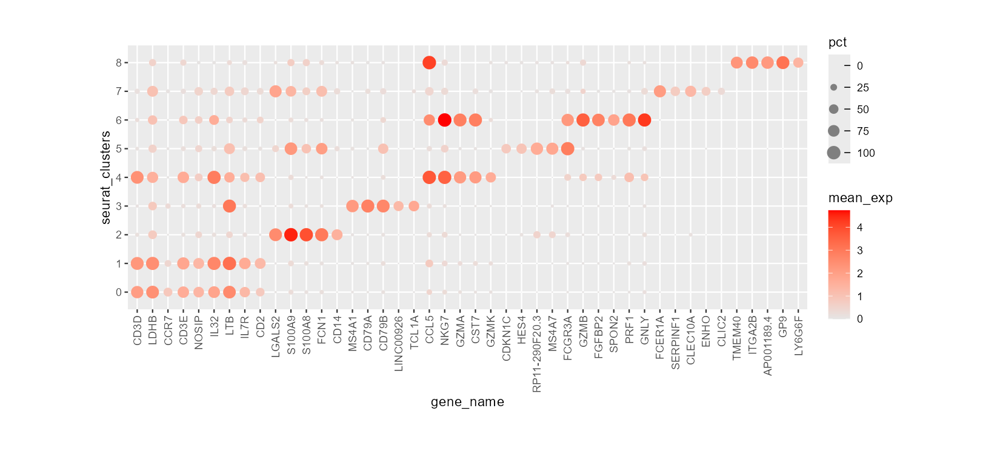

*Marker genes on the x axis, clusters on the y axis; dot size encodes the
percentage of expressing cells and colour the mean expression.*

`ggscplot()` does three things:

1. calls [`fetch_data()`](#3-preparing-the-data) to pull the reduction, the
   metadata and the expression of `features` out of the Seurat object,
2. builds a plain `ggplot()` with your `mapping`,
3. sets `coord_cartesian(clip = "off")` so that annotation drawn outside the
   panel (dendrograms, arrows, labels) is not clipped.

Everything after that is normal ggplot2.

---

## 3. Preparing the data

### 3.1 `fetch_data()`

```r
fetch_data(
  object        = NULL,          # Seurat object
  reduction     = "umap",        # reduction used for Dim1 / Dim2
  features      = NULL,          # genes to extract
  featuresAnno  = 0,             # annotation of each feature, same length as `features`
  pct.exp.var   = "seurat_clusters",  # grouping used for pct / mean_exp
  group.vars    = NULL,          # melt several metadata columns into one
  slot          = c("data", "counts")
)
```

The returned data frame is one row per **cell × feature** and contains:

| column | meaning |
|---|---|
| `Dim1`, `Dim2` | coordinates of the chosen reduction |
| `cell`, `ident` | cell barcode and `Idents()` |
| all metadata columns | copied from `object@meta.data` |
| `gene_name`, `value` | feature name and its expression |
| `mean_exp`, `median_exp` | mean / median expression of that feature in the group |
| `pct` | percentage of cells above zero in the group (0–100) |
| `featureAnno` | the value you passed in `featuresAnno` |

`mean_exp`, `median_exp` and `pct` are summarised **per `gene_name` ×
`pct.exp.var`**. If `features` contains a duplicated gene, the copies get a
`_1`, `_2`, … suffix so that they can be shown in different annotation groups.

### 3.2 `pct.exp.var` must match the variable you plot on `y`

This is the one rule that is easy to get wrong. `pct.exp.var` decides the
grouping of `pct` / `mean_exp`, so it has to be the **same variable you map to
the categorical axis**:

```r
# y = seurat_clusters  ->  the default pct.exp.var is fine
ggscplot(object = pbmc, features = genes,
         mapping = aes(x = gene_name, y = seurat_clusters,
                       fill = mean_exp, size = pct)) +
  geom_scDot()

# y = celltype  ->  summarise per celltype as well
ggscplot(object = pbmc, features = genes, pct.exp.var = "celltype",
         mapping = aes(x = gene_name, y = celltype,
                       fill = mean_exp, size = pct)) +
  geom_scDot()
```

If the two do not match — for example a `celltype` that is made of several
clusters — one `gene × celltype` position gets several different `pct` values
and several dots of different sizes are drawn on top of each other. That is
what a "double border" on some dots actually is. Since 0.0.4 `geom_scDot()`
collapses such duplicated positions to the largest dot and warns about it.

### 3.3 `featuresAnno` and ordering

Pass `featuresAnno` to tag every gene with the group it came from, then split
the panel with `facet_new()`:

```r
ggscplot(object = pbmc, features = genes, featuresAnno = anno,
         mapping = aes(x = gene_name, y = seurat_clusters,
                       fill = mean_exp, size = pct)) +
  geom_scDot() +
  facet_new(facet_col = "featureAnno", scales = "free_x",
            strip.col = circlize::rand_color(9),
            x.angle = 90, x.label.hjust = 1)
```

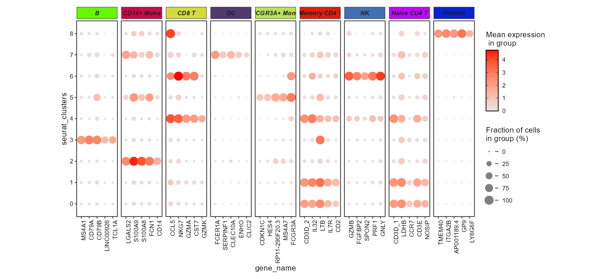

*`facet_new()` adds a coloured strip per group and frees the x axis of every
panel, so each block shows only its own markers.*

Use `gene.order` to force a different order of the x axis:

```r
ggscplot(..., gene.order = rev(genes))
```

### 3.4 `slot` / `layer`

`slot = "data"` (default) uses normalised expression, `slot = "counts"` uses raw
counts. ggSCvis detects the Seurat major version for you: `layer =` is used on
SeuratObject ≥ 5, `slot =` on SeuratObject < 5. For an object with split
`Assay5` layers (`counts.1`, `counts.2`, …) call `JoinLayers()` first.

### 3.5 Plotting an existing data frame

If you already have a data frame, skip `object` and pass it directly:

```r
df <- fetch_data(object = pbmc, features = genes)

ggscplot(data = df, mapping = aes(x = Dim1, y = Dim2, colour = seurat_clusters)) +
  geom_scPoint()
```

---

## 4. Plot types

All examples below reuse the same `genes` / `anno` objects built in
[§2](#2-quick-start).

### 4.1 Dot plot — `geom_scDot()`

Size usually encodes `pct`, colour encodes `mean_exp` — see the
[Quick start figure](#2-quick-start). Useful arguments:

| argument | default | meaning |
|---|---|---|
| `add.tree` | `FALSE` | draw dendrograms around the panel (see [5](#5-adding-dendrograms)) |
| `tree.type` | `"rectangle"` | `"rectangle"` or `"triangle"` |
| `add.tree.y`, `add.tree.x` | `FALSE` | which sides get a tree |
| `tree.y.side`, `tree.x.side` | `"left"`, `"bottom"` | placement of the trees |
| `tree.y.width`, `tree.x.height` | `0.06` | size of the tree in npc |
| `branch.side`, `branch.shift` | `"top"`, `0` | position of the feature-annotation bar |
| `branch.height`, `branch.len`, `branch.lwd` | `0.05`, `0.8`, `0.5` | geometry of that bar |

`add.tree = TRUE` needs an `exp` aesthetic, because the dendrogram is computed
from the values.

### 4.2 Tile / heatmap — `geom_scTile()`

```r
ggscplot(object = pbmc, features = genes,
         mapping = aes(x = gene_name, y = seurat_clusters, fill = mean_exp)) +
  geom_scTile() +
  scale_fill_gradient(low = "grey90", high = "red") +
  theme(axis.text.x = element_text(angle = 90, hjust = 1, vjust = 0.5))
```

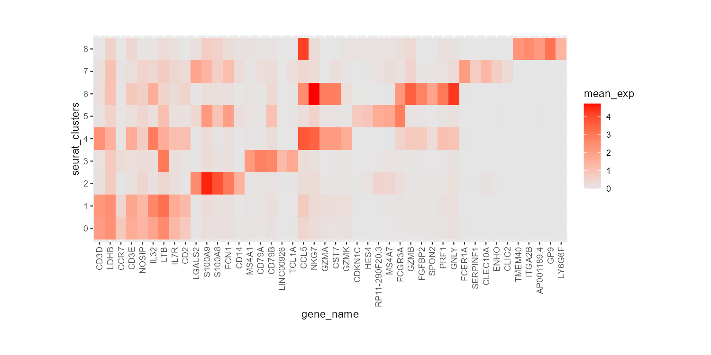

*`geom_scTile()` draws one rectangle per `gene × cluster`; adding `celltype`
turns on the annotation bar without drawing a dendrogram.*

### 4.3 Violin — `geom_scViolin()`

`geom_scViolin()` computes a density per group, so it needs `exp`:

```r
ggscplot(object = pbmc, features = genes,
         mapping = aes(x = gene_name, y = seurat_clusters,
                       fill = mean_exp, exp = value)) +
  geom_scViolin() +
  scale_fill_gradient(low = "grey90", high = "red") +
  theme(axis.text.x = element_text(angle = 90, hjust = 1, vjust = 0.5))
```

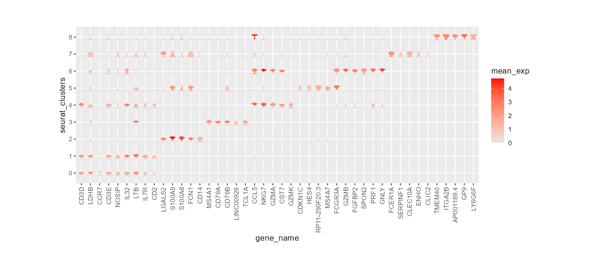

*Map `exp = value` (the raw per-cell expression) — that is what the density is
computed from; `fill` is still the group-level `mean_exp`.*

### 4.4 UMAP / embedding — `geom_scPoint()` and `geom_scPoint2()`

`geom_scPoint()` is a thin wrapper around `geom_point()` and pairs naturally
with `theme_sc()` (arrow axes):

```r
ggscplot(object = pbmc) +
  geom_scPoint(aes(colour = seurat_clusters), size = 0.8, stroke = 0) +
  theme_sc(x.label = "UMAP_1", y.label = "UMAP_2") +
  theme(legend.position = "bottom") +
  guides(colour = guide_legend(ncol = 3, override.aes = list(size = 2)))
```

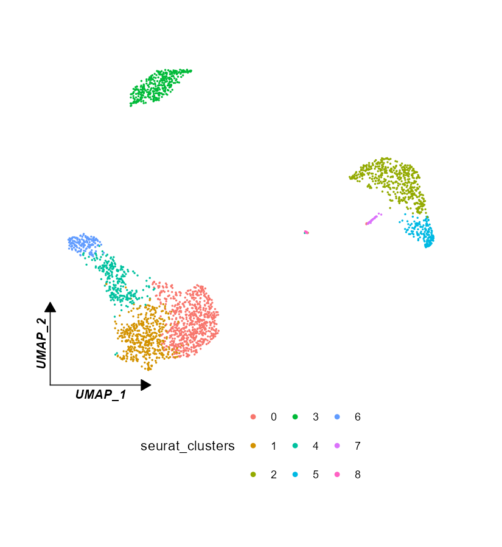

`geom_scPoint2()` additionally labels each cluster and can draw its own compact
legend inside the panel:

```r
ggscplot(object = pbmc, b = 0.35) +
  geom_scPoint2(aes(colour  = seurat_annotations,
                    cluster = seurat_annotations,
                    cluster_anno = seurat_clusters),
                show.legend = FALSE, add_label = FALSE,
                add_legend = TRUE,
                lgd_x = 0.5, ncol = 3, lgd_y = -0.25) +
  theme_sc(b = 0.35)
```

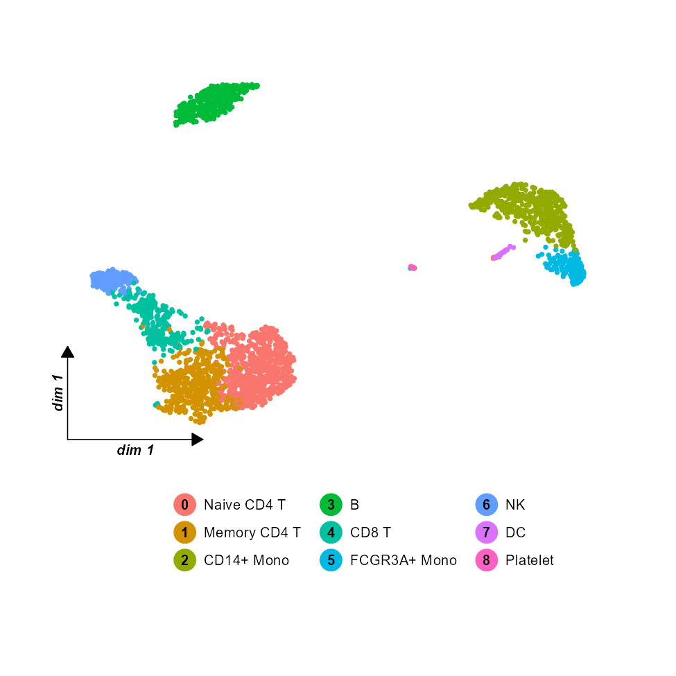

*`cluster_anno` adds the numeric cluster id in front of each label; `lgd_x` /
`lgd_y` / `ncol` move and reflow the legend.*

| argument | default | meaning |
|---|---|---|
| `add_label` | `TRUE` | print the cluster name at the centroid |
| `add_legend` | `FALSE` | draw a compact legend inside the panel |
| `point.size`, `point.label.size` | `2`, `10` | size of dots and labels |
| `ncol`, `hgap`, `vgap` | `1`, `1`, `0.5` | layout of that legend |
| `lgd_x`, `lgd_y`, `lgd_width`, `lgd_height` | `1.05`, `0.5`, `0.1`, `0.9` | position/size of the legend |

---

## 5. Adding dendrograms

`geom_scDot()`, `geom_scTile()` and `geom_scViolin()` all accept
`add.tree = TRUE`. The tree is built by hierarchical clustering of the `exp`
values, so map `exp`:

```r
ggscplot(object = pbmc, features = genes, featuresAnno = anno,
         mapping = aes(x = gene_name, y = seurat_clusters,
                       fill = mean_exp, size = pct, exp = mean_exp)) +
  geom_scDot(add.tree = TRUE, add.tree.y = TRUE, tree.y.side = "right",
             new.ylabel.x = 0, new.ylabel.rot = 45,
             branch.label.rot = 0, branch.label.hjust = 0.5,
             branch.label.shift = 1) +
  scale_fill_gradient(low = "grey90", high = "red") +
  theme_bw() +
  theme(axis.text.y = element_blank(),
        axis.text.x = element_text(angle = 90, hjust = 1),
        axis.text = element_text(colour = "black"),
        plot.margin = margin(t = 0.05, r = 0.25, b = 0.05, l = 0.05, unit = "npc"),
        legend.position = c(1.15, 0.5)) +
  ylab("")
```

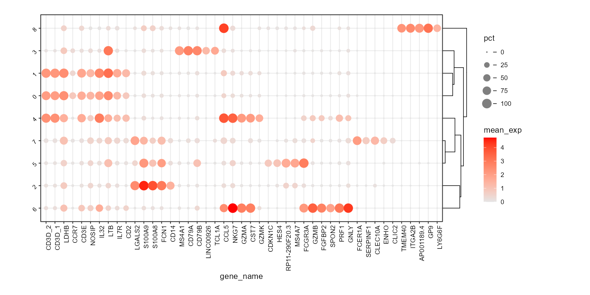

Related arguments: `tree.y.label.hjust` / `tree.x.label.hjust`,
`new.ylabel.size`, `new.ylabel.rot`, `new.xlabel.size`, `new.xlabel.rot`,
`tree.y.shift` / `tree.x.shift`. Set `add.tree.x = TRUE` together with
`add.tree.y = TRUE` to get a tree on both axes.

---

## 6. Faceting

### `facet_new()`

The most convenient entry point: it wraps the panel with coloured strips and
takes care of the margins — used in [§3.3](#33-featuresanno-and-ordering).

| argument | meaning |
|---|---|
| `facet_col`, `facet_row` | metadata columns used for the columns / rows |
| `scales`, `space` | passed to the underlying facet (`"free_x"` by default) |
| `strip.col` | vector of strip background colours |
| `no.xlabel`, `no.ylabel` | suppress axis text (useful when the geom draws its own) |
| `x.angle`, `x.label.hjust` | rotation / justification of the x labels |
| `t`, `r`, `b`, `l` | panel margins in npc |
| `legend.position` | where to put the legend |

### Other facet helpers

`facet_feature()` draws one panel per gene with a coloured strip — ideal for a
grid of embeddings:

```r
genes8 <- c("MS4A1", "GNLY", "CD3E", "CD14", "FCER1A", "FCGR3A", "LYZ", "PPBP")

ggscplot(object = pbmc, features = genes8) +
  geom_scPoint(aes(colour = value), size = 0.3) +
  scale_colour_gradient(low = "grey90", high = "red") +
  theme_sc(x.label = "UMAP_1", y.label = "UMAP_2") +
  facet_feature(strip.col = circlize::rand_color(8))
```

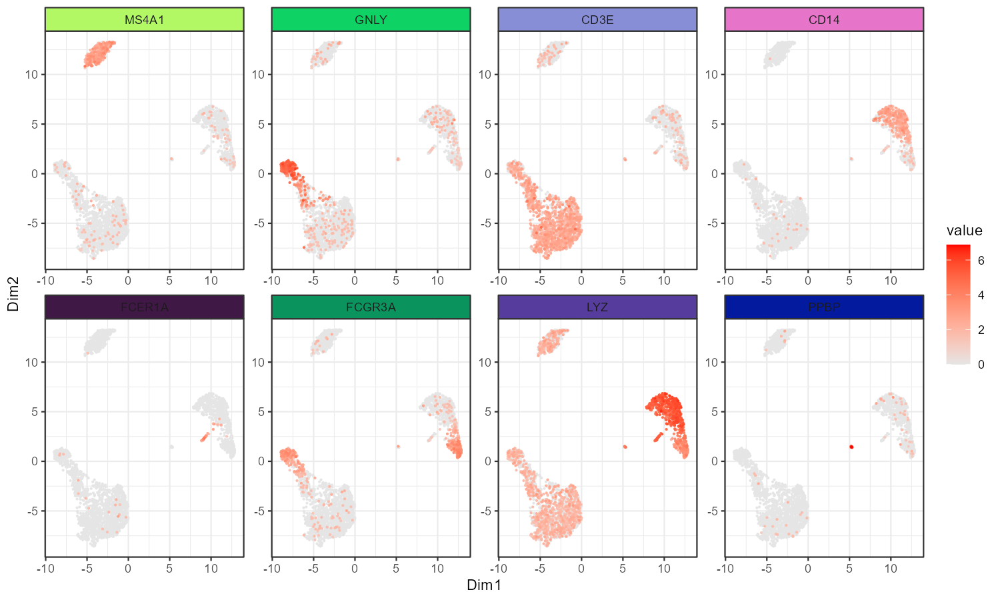

```r
# heatmap-like layout: rows and columns
ggscplot(object = pbmc, features = genes,
         mapping = aes(x = cell, y = gene_name)) +
  geom_tile(aes(fill = value)) +
  facet_hetamap(facet_col = "seurat_clusters",
                strip.col = circlize::rand_color(9))

# the ggplot2 facets, extended with the same strip styling
ggscplot(object = pbmc, features = genes, featuresAnno = anno,
         mapping = aes(x = gene_name, y = seurat_clusters, fill = mean_exp)) +
  geom_scTile() +
  facet_wrapnew(~featureAnno, scales = "free_x")

ggscplot(object = pbmc, features = genes, featuresAnno = anno,
         mapping = aes(x = gene_name, y = seurat_clusters, fill = mean_exp)) +
  geom_scTile() +
  facet_gridnew(rows = vars(featureAnno), cols = vars(seurat_clusters))
```

---

## 7. Annotation

### `geom_markArrow()` — axis arrows

```r
ggscplot(object = pbmc, features = genes8) +
  geom_scPoint(aes(colour = value), size = 0.3) +
  scale_colour_gradient(low = "grey90", high = "red") +
  facet_wrap(~gene_name, ncol = 4) +
  theme_classic() +
  theme(axis.ticks = element_blank(), axis.text = element_blank(),
        strip.background = element_blank(),
        strip.text = element_text(face = "bold", size = rel(1)),
        axis.line = element_blank(), panel.border = element_blank(),
        panel.spacing = unit(0.1, "npc")) +
  geom_markArrow(facet.vars = list(gene_name = factor("CD14", levels = genes8)),
                 rel.pos = 0, label.shift = c(0.1, 0.1))
```

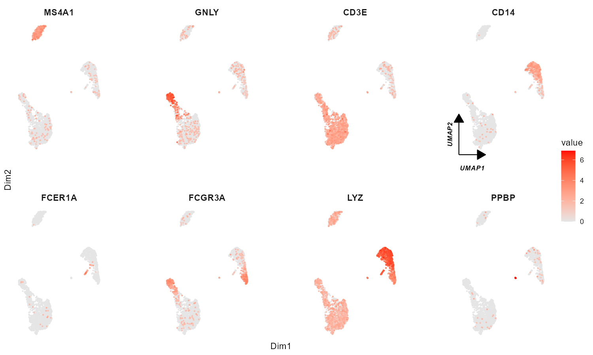

*`facet.vars` places the arrow in one specific panel. Other arguments:
`rel.pos` / `rel.len` (position and length of the arrow), `label`,
`label.size`, `label.shift`, `corner.pos` (`"left_b"`, `"right_b"`, …) and
`arrow` (a `grid::arrow()`).*

### `geom_marklabel()` — leader-line labels

```r
set.seed(1)
mark_gene <- sample(mk$gene, 8)

ggscplot(object = pbmc, features = mk$gene,
         mapping = aes(x = cell, y = gene_name)) +
  geom_tile(aes(fill = value)) +
  scale_fill_gradient(low = "grey90", high = "red") +
  facet_wrap(~seurat_clusters, nrow = 1, scales = "free_x") +
  geom_marklabel(data = . %>% dplyr::filter(seurat_clusters == "8"),
                 mark.label = mark_gene) +
  theme(axis.text.x = element_blank(), axis.ticks.x = element_blank(),
        legend.position = "left",
        plot.margin = margin(r = 0.15, unit = "npc"))
```

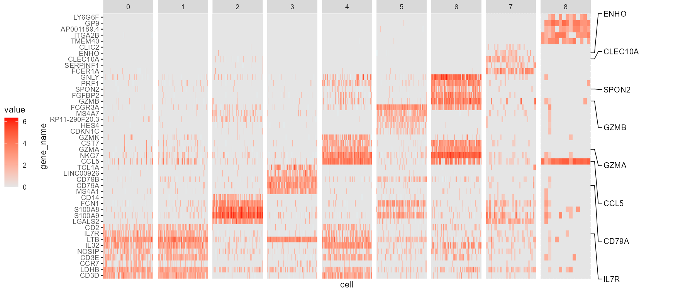

*`pos` (`"right"`, `"left"`, `"top"`, `"bottom"`), `link.start.type` /
`link.end.type` (`"line"`, `"circle"`, `"arrow"`), `link.line.length`,
`link.label.space`, `mark.scale` and `use.smartAlign2` control the look.*

### `create_annosegment()`

Builds the horizontal/vertical segment bar used by the `celltype` aesthetic;
call it directly if you want to compose your own grob tree.

---

## 8. Theme, scales and coordinates

### `theme_sc()`

A minimal single-cell theme with arrow axes drawn by `element_line2()` — it is
what draws the axes in the two UMAP panels of [§4.4](#44-umap--embedding--geom_scpoint-and-geom_scpoint2):

```r
ggscplot(object = pbmc) +
  geom_scPoint(aes(colour = seurat_clusters), size = 0.8, stroke = 0) +
  theme_sc(x.label = "UMAP_1", y.label = "UMAP_2")
```

Set `add.arrow = FALSE` to keep the axis lines but drop the arrow heads;
`label.shift`, `fontsize`, `border.col` and the margins `t`/`r`/`b`/`l` are
passed through.

### `element_line2()`

The theme element behind those axes — a line with an arrow head and a label:

```r
theme(axis.line.x.bottom = element_line2(x.line.ed = 0.25, label = "UMAP_1"))
```

### Random colours

```r
scale_fill_random(seed = 1)      # fill
scale_color_random(seed = 1)     # colour
```

Both accept `hue`, `luminosity`, `transparency`, `friendly` and a `seed`, so a
figure can be reproduced exactly.

### `coord_polar2()`

A `coord_polar()` that fixes the two most annoying limitations — an inner
radius and partial circles. Here it turns cell-type counts into a donut:

```r
polar_df <- as.data.frame(table(pbmc$seurat_annotations))
colnames(polar_df) <- c("variable", "value")

ggplot(polar_df, aes(x = "", y = value, fill = variable)) +
  geom_col(width = 1, colour = "white") +
  coord_polar2(theta = "y", r0 = 0.5, r1 = 1) +
  scale_fill_manual(values = circlize::rand_color(nrow(polar_df))) +
  labs(fill = NULL) +
  theme_void()
```

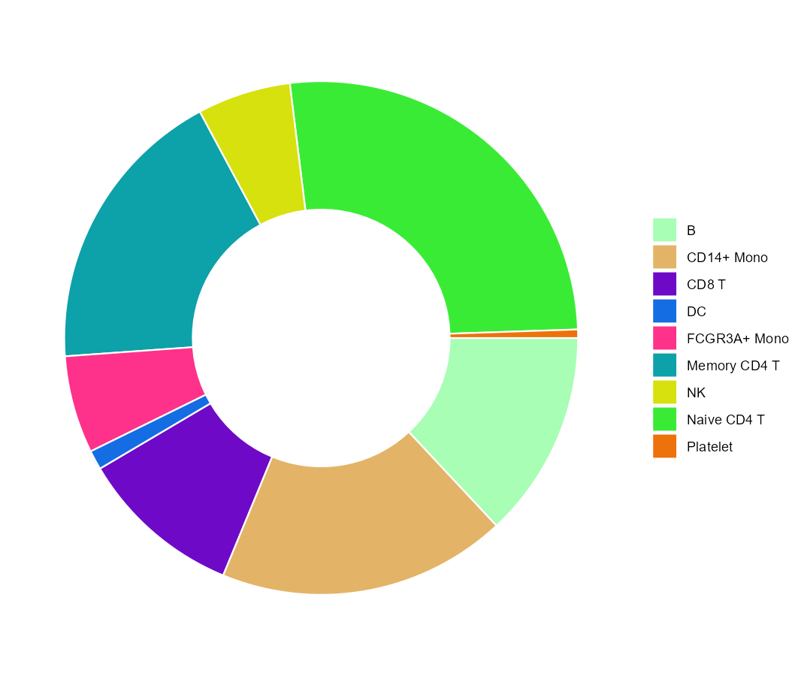

*`r0` / `r1` set the inner and outer radius, `start` / `end` the angular
range, and `nice.facing` / `x.label.pos` / `x.label.shift` control the tick
labels.*

### `legendGrob2()`

Draws a legend with points and labels as a grob — handy when you need a
compact key inside the panel, as `geom_scPoint2(add.legend = TRUE)` does.

---

## 9. Compatibility

| component | supported |
|---|---|
| Seurat | v4 (`Assay`) and v5 (`Assay5`) |
| SeuratObject | < 5 (`slot =`) and ≥ 5 (`layer =`, detected automatically) |
| ggplot2 | 3.5.x and 4.x |

ggSCvis reuses a few internal ggplot2 helpers. The ones that were renamed or
changed in ggplot2 4.0.0 (`is.zero()`, `check_labeller()`, `weave_axes()`) are
resolved at call time in `R/utils-compat.R`, so the same source runs on both
major versions. Before 0.0.4 the package failed to install on ggplot2 4.0.

Objects with split `Assay5` layers should be joined first:

```r
obj <- JoinLayers(obj)
```

---

## 10. Troubleshooting

**`The slot argument of FetchData() was deprecated ... and is now defunct`**
You are on ggSCvis < 0.0.4 with SeuratObject ≥ 5. Upgrade, or call
`JoinLayers()` / pass `slot` through the fixed `fetch_data()`.

**`object 'is.zero' not found` while installing**
ggplot2 4.0.0 removed `is.zero()`. Fixed in 0.0.4.

**`Can't recycle '<quos>' (size 0) to match ...` from `facet_wrapnew()`**
`compact_facets()` in ggplot2 4.0 already normalises the facets; fixed in 0.0.4.

**Some dots show a "double border"**
`pct.exp.var` does not match the variable mapped to `y`. Set it explicitly,
e.g. `pct.exp.var = "celltype"` when you plot `y = celltype`. See
[3.2](#32-pctexpvar-must-match-the-variable-you-plot-on-y).

**`'x' and 'unit' must have length > 0` from `tidydr::theme_dr()`**
That error comes from `tidydr`, not from ggSCvis (the package does not use
`tidydr`). Use `theme_sc()` or `theme_classic()` instead, or wait for the
upstream fix.

**Legend keys do not match the dots**
`geom_scDot()`'s key is drawn with a fixed grey fill; map the colour to a
discrete variable and use `scale_fill_manual()` if you need exact keys.

**My edit to the source did not take effect after reinstalling**
R keeps the loaded namespace in memory. Restart R after
`R CMD INSTALL` / `install_github()`, and reinstall with `force = TRUE`:

```r
remotes::install_github("junjunlab/ggSCvis", force = TRUE, upgrade = "never")
```

---

## Related blogs

The examples above follow these published walk-throughs:

- [单细胞二维密度图一文拿捏!](https://mp.weixin.qq.com/s?__biz=MzkyMTI1MTYxNA==&mid=2247512783&idx=1&sn=2535eaafd12934a3067e88f00f17d59a&chksm=c18488bef6f301a8fcd1efa4dbe75d2c0d794cdedde2151528d3841e61e902d9c3ebbc2915c4&token=1867459500&lang=zh_CN#rd)
- [coord_polar2 补充极坐标图形短板](https://mp.weixin.qq.com/s?__biz=MzkyMTI1MTYxNA==&mid=2247512748&idx=1&sn=6678a6672774f1a629701ea74db526fa&chksm=c18488ddf6f301cb2522153dfab8b690bd26ea46e7db2fc03dcf923daef3f594b0442dadd9a6&token=1867459500&lang=zh_CN#rd)
- [ggplot 绘制热图标注特定名称](https://mp.weixin.qq.com/s?__biz=MzkyMTI1MTYxNA==&mid=2247512715&idx=1&sn=e599a44ed4013bf5512dc5f926833495&chksm=c18488faf6f301ecdcd5dd4b5324fb6b86a560ce381102c45111e7ac9498ff10648127086b19&token=2102927728&lang=zh_CN#rd)
- [ggSCvis 可视化 dot/heatmap/violin plot 示例](https://mp.weixin.qq.com/s?__biz=MzkyMTI1MTYxNA==&mid=2247512269&idx=1&sn=0208555abacffaed2e8a8437c8b43214&chksm=c1848abcf6f303aa83091c6c517b054ba4f7da2edc8de0fb86a2878064a91375a67cee89fd3b&token=864433526&lang=zh_CN#rd)
- [给你的亚群添加编号](https://mp.weixin.qq.com/s?__biz=MzkyMTI1MTYxNA==&mid=2247512189&idx=1&sn=1cc5cb6167f9d3960922dd691aa376db&chksm=c1848a0cf6f3031a4b9b1ab4195d525269703553f84ef29ea312878c60accfec07ca3a3102d6&token=864433526&lang=zh_CN#rd)
- [ggSCvis 让你的单细胞可视化 gg 起来](https://mp.weixin.qq.com/s?__biz=MzkyMTI1MTYxNA==&mid=2247512093&idx=1&sn=b44680cfccfa7c0bb0a59eef29b944fc&chksm=c1848a6cf6f3037ad9e74e898575125b0cbd0d372c25805315559e5e41c9168c6e8612418896&token=864433526&lang=zh_CN#rd)

---

## Links

- Issues and questions: <https://github.com/junjunlab/ggSCvis/issues>
- Source: <https://github.com/junjunlab/ggSCvis>
- Related package (circular plots): <https://github.com/junjunlab/ggcirclize>
